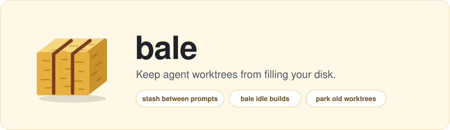
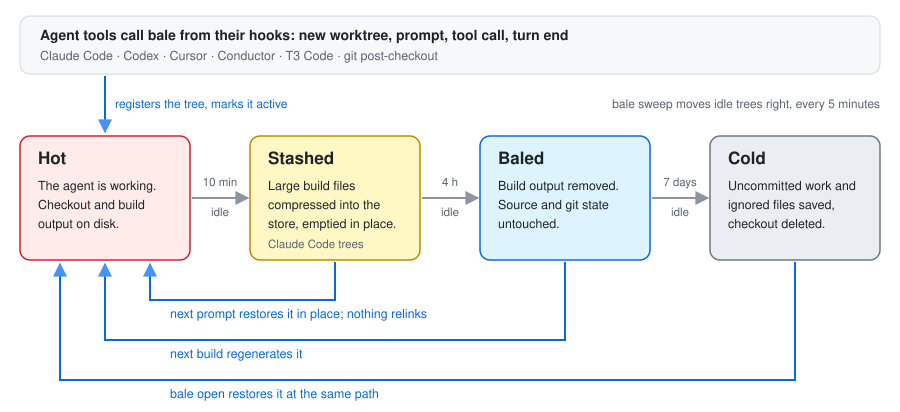

<p align="center">
  
</p>

Run four coding agents at once and you have a dozen worktrees, each with its own build output. One
iOS app's worktree holds 9.4 GiB of DerivedData, so a dozen of them is over 100 GiB. Deleting worktrees
by hand loses uncommitted work, and deleting build output means waiting for a full rebuild the next
time an agent picks the tree up.

bale hooks into the agent tools, notices which trees are idle, and shrinks them in steps. A stashed or
baled tree fills back in when an agent uses it again; a cold one comes back with `bale open`.



## What it does

- **Stashes build output between prompts.** Ten minutes after a Claude Code session goes quiet, bale
  compresses the tree's large build files into a deduplicated zstd store and empties them in place. On
  the next prompt the hook writes them back into the same inodes before any tool runs, so Xcode sees
  nothing changed. On an iOS app's tree, a stash freed 5.0 GiB and stored 979 MiB, and the build after
  the restore compiled and linked nothing ([bench](docs/bench/2026-10-warm-tier.md)).
- **Bales idle trees.** After 4 hours idle, bale deletes the tree's regenerable build output: Xcode
  DerivedData (including folders an agent pointed `-derivedDataPath` at), Gradle's `build`, `.gradle`,
  `.kotlin` and `.cxx`, SwiftPM's `.build`, and any directory you list under `regenerable` in
  `.bale.toml`. Source and git state stay untouched; the next build regenerates it.
- **Takes abandoned trees cold.** After 7 days idle, bale saves the tree's uncommitted work and ignored
  files and deletes the checkout. `bale open` puts it back at the same path. It refuses a tree that a
  process still holds.
- **Shares Swift packages across worktrees.** Trees of the same repo link one `SourcePackages` copy,
  which saved about 2.1 GiB per extra tree on the same app ([bench](docs/bench/2026-10-shared-packages.md)).
- **Cleans up after agents that are gone.** DerivedData left in a finished session's scratchpad is
  deleted once its project has been gone for an hour and nothing holds it.
- **Stays out of the way.** A hook call on a tree that isn't stashed takes about 20 ms. Setup hooks never
  fail the tool, and `bale pin` keeps the sweep away from a tree you want left alone.

## What it looks like

`bale history` reads bale's local trace and shows, per day, the lowest free space and what each step
freed. This is one Mac running several agent sessions, 2026-10-28 to 2026-10-30:

```
DAY (UTC)   SWEEPS            LOWEST FREE          UP        COLD        REAP      SPM_GC          GC
2026-10-28      14      40.4 GiB at 18:13    20.2 GiB     2.8 GiB           -           -           -
2026-10-29     114      31.8 GiB at 15:08    30.9 GiB   144.9 MiB           -     4.5 GiB           -
2026-10-30     182      21.3 GiB at 04:49    58.8 GiB           -    35.7 GiB    18.2 GiB           -

freed 171.2 GiB (cold 2.9 GiB, reap 35.7 GiB, spm_gc 22.7 GiB, up 109.9 GiB)
lowest free 21.3 GiB at 2026-10-30 04:49 UTC
Freed bytes count each removal, so output that is rebuilt and removed again counts twice.
```

`bale history --html chart.html` draws the same data as a chart.

## Quick start

Pick one of these. Each gets you a prebuilt binary for macOS (Apple Silicon or Intel) or Linux (x86_64 or
arm64).

**Claude Code plugin.** The plugin downloads bale, installs the sweep and registers the Claude Code hooks,
so there is nothing else to run:

```
/plugin marketplace add bmcreations/bale
/plugin install bale@bale
```

bale downloads when the next session starts, into the plugin's data directory. A plugin's `WorktreeCreate`
hook does not run for `claude --worktree --tmux`, so if you start sessions that way, use one of the other
installs and `bale install --hooks claude` instead. Plugin hooks also run alongside hooks in
`settings.json`: if you already ran `bale install --hooks claude`, remove those with
`bale uninstall --hooks claude` before installing the plugin.

**Homebrew:**

```
brew trust bmcreations/tap   # Homebrew asks before loading a third-party tap
brew install bmcreations/tap/bale
bale install                 # sweep every 5 minutes (launchd on macOS)
bale install --hooks claude  # or codex, t3; git, conductor, cursor also take --repo <repo>
```

**Install script** (installs to `~/.local/bin`; set `BALE_INSTALL_DIR` to change that):

```
curl -fsSL https://raw.githubusercontent.com/bmcreations/bale/main/install.sh | sh
bale install
bale install --hooks claude
```

**From source:**

```
cargo build --release -p bale-cli
cp target/release/bale ~/.local/bin/
```

Then `bale ls` lists the registered trees and their levels.

`bale <command> --help` lists every command's flags. New worktrees register through the hooks. To bring
in worktrees that already exist, run `bale migrate <repo>` to see the plan and `bale migrate <repo>
--apply` to adopt them.

bale runs day to day on macOS. CI runs the tests on macOS, Linux and Windows; nothing has been run on
Windows outside CI yet.

How it works: `docs/architecture.md`. Working on bale: `AGENTS.md`.

## Install and uninstall

`bale install` with no flags installs the sweep schedule: `bale sweep` every 5 minutes through launchd on macOS, or every 30 minutes through
a systemd user timer or Task Scheduler. It does not touch any tool's configuration.

`bale install --hooks <LIST>` installs only the hooks of the tools in the comma-separated list, and not the
schedule. The tools are `claude`, `git`, `conductor`, `cursor`, `codex` and `t3`. `--repo <REPO>` names the repo
whose files to edit; it is required for `git`, `conductor` and `cursor`. `--print-only` prints the files
and commands without changing anything.

```
bale install --print-only
bale install --hooks claude
bale install --hooks git,conductor,cursor --repo ~/dev/myrepo
bale install --hooks codex,t3
```

`bale uninstall` takes the same `--hooks`, `--repo` and `--print-only`. Without `--hooks` it removes the
sweep schedule; with it, only bale's own entries in those tools' hooks. Saved state and cold worktrees are
kept. A config file that uninstall leaves empty is deleted only when bale created it: if bale finds a
backup of the file, or git tracks it, the file stays.

Before editing a config, install keeps a copy of the original under `$BALE_HOME/backups`
(`~/.bale/backups` by default). It reformats a JSON file and says so in its output.

## Hooks per tool

Each hook is a `bale hook <tool> ...` command that the tool runs. Setup hooks register the new worktree
with bale and never fail the tool: errors go to stderr and the exit status is 0. Where a tool has no
remove hook, the sweep covers its idle trees.

| Tool | What `bale install --hooks` does | What the hook does | Status |
|---|---|---|---|
| Claude Code | Adds `WorktreeCreate`, `WorktreeRemove`, `UserPromptSubmit`, `PreToolUse` (every tool, no matcher) and `Stop` entries to `~/.claude/settings.json` (`$CLAUDE_CONFIG_DIR/settings.json` when that is set), keeping other hooks. Refuses when you already have a `WorktreeCreate` hook of your own. A `WorktreeRemove` hook of your own stays; Claude Code runs it in parallel with bale's, so it may find the tree already gone. | `create` makes the worktree with `bale new` and prints its path (it falls back to plain `git worktree add` when bale fails), and records the session. `remove` takes the worktree cold instead of deleting it. `prompt` records the activity and, when the tree is stashed, starts restoring it in a detached `bale unstash --background` and returns at once, so the prompt does not wait for the disk writes. `pre-tool` runs before every tool call and waits for that restore to finish (it does the restore itself if it gets there first); a tree that is not stashed costs about 20 ms. A background restore that fails leaves its error under `$BALE_HOME/restore-failed/`, and the next prompt or tool call shows it once and exits 2. `stop` records the turn's end. | Verified by tests |
| git | Writes `post-checkout` in the repo's hooks dir (honouring `core.hooksPath`). An existing hook is moved to `post-checkout.pre-bale` and called by bale's. | `post-checkout` registers a linked worktree that `git worktree add` just created. | Verified by tests |
| Conductor | Chains bale after your `setup` script and after your `archive` script in `<repo>/.conductor/settings.toml`. Your scripts and other keys stay. | `setup` registers the workspace. `archive` takes it cold; it exits 3 when something holds the tree and 4 when bale skipped it. | Unverified: not run against Conductor |
| Cursor | Appends bale's command to the setup command list in `<repo>/.cursor/worktrees.json`. Refuses when the setup entry is a script path. | `setup` registers the worktree. Cursor has no remove hook. | Unverified: not run against Cursor |
| T3 Code | Adds a `bale-setup` script (run on worktree create) and a `bale-settle` script (run when a thread settles) to `defaultProjectScripts` in `~/.t3/userdata/settings.json` (`$T3CODE_HOME/userdata/settings.json` when that is set). T3 Code runs only the first script with each flag, so when you already have one, bale's call goes in front of its command and your command still runs after it. These defaults reach every project when `projectSettingsFolded` is true in that file; a project with its own scripts or a script override does not run them. | `setup` registers the thread's worktree (`$T3CODE_WORKTREE_PATH`, else the current directory). `settle` records that a turn ended: it moves the tree's last activity to now and writes a `touch` line to the trace, registering the tree first if bale does not track it. It never bales or colds the tree, so the build stays warm between turns; the sweep applies the idle policy from the last turn's end. T3 Code has no remove hook. | Unverified: written from T3 Code's app bundle, not run against T3 Code |
| Codex | Writes nothing. Prints the command to add to the setup script of your Codex local environment (Codex app Settings). | `setup [<path>]` registers the worktree (default: the current directory). Codex has no remove hook. | Unverified: not run against Codex |

The Conductor and Cursor files usually live in the repo and are committed, so an install changes a file
your team shares.

"Unverified" means the adapter is written from the tool's documentation (for T3 Code, its app bundle) and its own tests, and nobody has
yet created a workspace in the tool and watched the hook run. The process names the Conductor archive path
uses to ignore Conductor itself are a guess until then.

## Day-to-day commands

| Command | What it does |
|---|---|
| `bale history [--days N] [--json] [--html FILE]` | Per UTC day over the last N days (default 7): sweeps run, the lowest free space they measured, and the bytes `up`, `cold`, `reap`, `spm_gc` and `gc` freed, read from the usage trace. `--html` also writes a chart. |
| `bale ls [--json]` | Lists registered worktrees: id, level, last activity, branch, session and path. A `*` before the level marks a pinned tree. |
| `bale show [TARGET]` | Shows one tree: level, pin, origin tool and session, title, and a git scope (branch and upstream, unpushed commits, last commit, uncommitted changes). |
| `bale pin [TARGET]` / `bale unpin [TARGET]` | Pinned trees are skipped by `bale sweep`. |
| `bale sweep [--dry-run]` | Applies the idle policy to every registered tree. |
| `bale up TARGET` | Removes a tree's regenerable build output in place. |
| `bale cold TARGET` | Saves uncommitted work and ignored files, then deletes the checkout. |
| `bale open TARGET` | Restores a cold tree at its path and removes the saved state. |
| `bale share TARGET` | Replaces the tree's tracked files of 1 MiB or more with clones of one stored copy (APFS, and Linux filesystems with reflinks). |
| `bale migrate REPO... [--apply]` | Shows the plan for adopting a repo's existing worktrees; `--apply` registers and bales them. |
| `bale new NAME`, `bale adopt [PATH]` | Create and register a worktree, or register one that exists. |
| `bale gc [--dry-run]` | Forgets trees that are gone, clears stale leftovers, and removes stored clone copies no tree uses. |

`TARGET` is a worktree path or an id from `bale ls`. `bale show` and `bale pin` default to the current
directory.

The `SESSION` column of `bale ls` is the tree's session title when bale knows it. Otherwise it is the
newest commit subject, or the one saved when the tree went cold. Of the tools, only Claude Code supplies a
session title today (bale reads it from Claude Code's transcript under `~/.claude/projects/`). Cursor,
Codex and T3 Code trees record the tool as their origin with no session or title; other trees show no title.

By default `bale sweep` bales a tree idle for 4 hours and takes one idle for 7 days cold. Set
`idle_baled_hours` and `idle_cold_days` in `$BALE_HOME/config.toml`, or per repo in `<repo>/.bale.toml`.
The sweep and `bale new` also share large tracked files between trees; set `share_checkouts = false` to turn
that off, or `clone_min_bytes` to change the 1 MiB cut.
The sweep's stash step only stashes trees where Claude Code's restore hook (`prompt` or `pre-tool`) has run, because no other tool restores stashed files; `bale stash` by hand works on any tree.
On macOS the sweep also checks Claude Code's session scratchpads (`/tmp/claude-<uid>/<project>/<session>/scratchpad`) for Xcode DerivedData folders at most two levels deep, and deletes one once its project has been gone for an hour and no process holds it. Set `BALE_CLAUDE_TMP` to look under another folder instead of `/tmp`.
`bale up` on macOS also removes the tree's `-derivedDataPath` folders that bale has learned (from a hook or a scratchpad) and that no process holds, then links each one back to the tree's shared Swift packages.

Small notes the agent keeps in a tree and git ignores (`.claude/state/` handoff notes and `.claude/plans/` by
default) are copied to `$BALE_HOME/keep/<id>/` by Claude Code's `stop` hook and T3 Code's settle script. When a
host deletes a worktree and makes it again at the same path, the next Claude Code prompt puts back each kept
file the tree lacks; it never overwrites a file, and it writes a `restore-kept` line to the trace. Files over
`keep_max_file_bytes` (1 MiB) are skipped and a tree's store stops growing at `keep_max_total_bytes` (10 MiB).
Set `keep_paths = [...]` (relative to the tree) in `config.toml` or `.bale.toml` to change the list, or
`keep_paths = []` to turn it off. Files you delete on purpose stay in the store, so a later restore can bring
them back; `bale gc` removes the store of a forgotten tree after 30 days.

Known limitations:

- Removing Xcode DerivedData that lives inside a worktree also removes its `SourcePackages/checkouts`.
  Local edits to a package checkout are lost; Xcode fetches it again on the next resolve.
- bale treats a directory in a Xcode or SwiftPM tree as DerivedData only when it holds an `info.plist`
  with a `WorkspacePath` and a `Build` directory, and git ignores all of it. On macOS one at most two
  levels into the tree (`.dd`, `build/dd`) goes even when git doesn't ignore it, unless git tracks a
  file in it. On a case-insensitive filesystem the names `info.plist` and `Build` also match other
  letter cases.
- After a tree goes cold, `git worktree add` at the same path fails with "missing but locked worktree",
  so a tool's own unarchive or re-create at that path may fail. Use `bale open <path>` to bring the tree
  back instead.
- Nothing has run on Windows yet; the Windows code is only checked by clippy.

## For agents

An agent reading this repo, or a CLAUDE.md or AGENTS.md pointer to it, can use these:

- `bale new <name> [--repo <repo>] [--branch <branch>] [--print-path]` creates a linked worktree, registers
  it, and with `--print-path` prints only its path.
- `bale open <target>` restores a cold worktree before you work in it. A baled one needs no open; the
  next build refills it.
- `bale cold <target>` saves the tree's uncommitted work and ignored files and deletes the checkout. It
  refuses a tree that something is still using. Exit 0 is cold or already gone, 3 is busy, 4 is skipped
  with the reason on stderr, 1 is an error.
- `bale ls` lists the worktrees and their levels, so you can see which are cold. `--json` gives records.

## Usage trace

bale keeps a local log of how worktrees are used, so a benchmark can replay it later. It writes JSON
lines to `$BALE_HOME/trace/` (`~/.bale/trace/` by default), one file per UTC day. It records each sweep,
each registered tree on every sweep, each `new`, `adopt`, `up`, `cold`, `open` and `gc` with its outcome
and duration, and the Xcode builds found in DerivedData build logs. No file contents are recorded.

The trace stays on your machine; bale does not send it anywhere. `bale trace path` prints the directory,
files older than 60 days are deleted at the end of each sweep, and `rm -r "$(bale trace path)"` deletes
it. The fields, the sizing limits and the exact meaning of each line are in `docs/usage-trace.md`.
